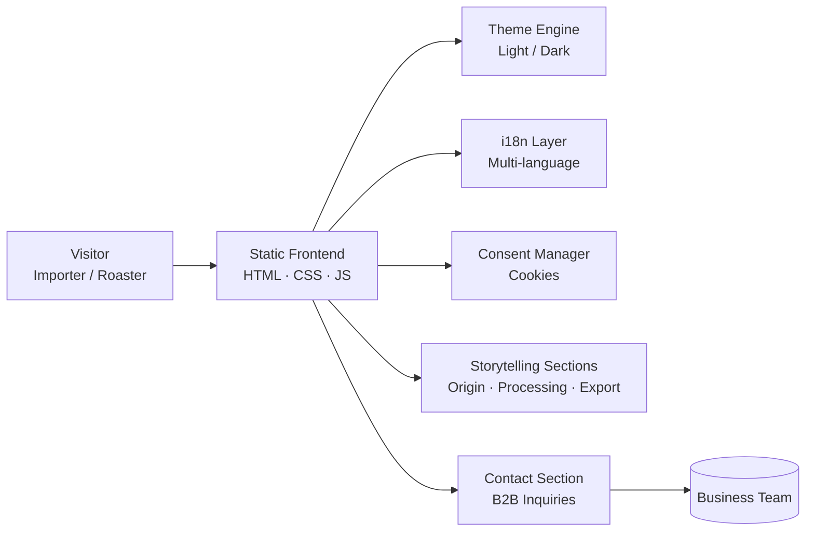
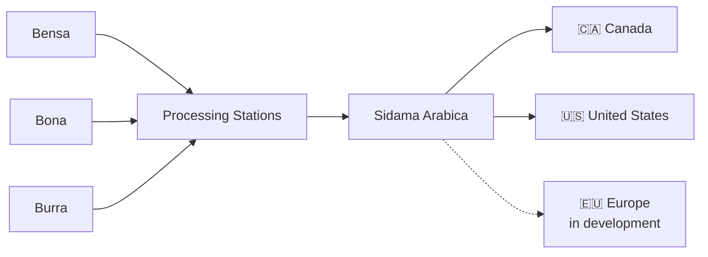

<div align="center">


<a href="https://github.com/abinetadmasucoffee/abinetadmasucoffee.github.io">
  
</a>

<br/>


**[🌐 Live Website](https://abinetadmasucoffee.github.io)** &nbsp;•&nbsp; **[📬 Contact](#-contact)** &nbsp;•&nbsp; **[🧭 Architecture](#-architecture)** &nbsp;•&nbsp; **[🌍 Market Strategy](#-european-market-strategy)**

</div>

---

## ☕ Overview

A production-grade business website for **Abinet Admasu Coffee (RAY General Trading)**, an Ethiopian exporter of premium **Sidama Arabica**. The platform pairs specialty-coffee branding with a modern engineering approach to establish international credibility and open direct channels to importers and roasters.

| | |
|---|---|
| **Product** | Premium Sidama Arabica coffee |
| **Origin network** | Processing stations in Bensa, Bona and Burra |
| **Export track record** | Canada, United States |
| **Growth target** | European specialty-coffee market |

---

## 🎯 Objectives

```text
01  Build international business credibility
02  Connect with coffee importers and roasters
03  Present Ethiopian origin and export capability
04  Grow visibility across European markets
05  Showcase international export activity
```

---

## ✨ Feature Set

<table>
<tr>
<td width="50%" valign="top">

### 🎨 Experience
- Premium coffee-inspired UI/UX
- Light / Dark mode
- Smooth animations and transitions
- Interactive sections and visual storytelling

</td>
<td width="50%" valign="top">

### ⚙️ Engineering
- Responsive, mobile-first layout
- Multi-language support
- Cookie consent system
- Business contact section

</td>
</tr>
<tr>
<td colspan="2" valign="top">

### 📖 Content
- Ethiopian origin and coffee processing storytelling
- International business presentation for B2B buyers

</td>
</tr>
</table>

---

## 🧭 Architecture



---

## 🌱 Origin to Export



---

## 🌍 European Market Strategy

| Pillar | Focus |
|---|---|
| **Coffee expos** | Direct presence with European buyers |
| **Roaster outreach** | Targeted relationships with specialty roasters |
| **Networking** | Trade community and partner introductions |
| **Branding** | Consistent premium origin identity |
| **Digital transformation** | This platform as the central business touchpoint |

---

## 🛠️ Tech Stack

<div align="center">


</div>

<details>
<summary><b>Engineering principles</b></summary>

<br/>

- **Mobile-first** responsive design across all breakpoints
- **Accessible theming** with light and dark modes
- **Performance-minded** static delivery with no backend dependency
- **Privacy-aware** with an explicit cookie consent flow
- **Localized** content to serve an international audience

</details>

---

## 🚀 Run Locally

```bash
git clone https://github.com/abinetadmasucoffee/abinetadmasucoffee.github.io.git
cd abinetadmasucoffee.github.io

# Option 1: open index.html directly in a browser
# Option 2: serve it locally
python3 -m http.server 8000
# then visit http://localhost:8000
```

---

## 👨‍💻 Developer

<div align="center">

**Simon Wolde Balango**
*Computer Engineering Student*
University of Genova, Imperia Campus, Italy

</div>

> *"Connecting Ethiopian Coffee & Technology."*

---

## 📬 Contact

For partnerships, sourcing and import inquiries, please use the contact section on the **[live website](https://abinetadmasucoffee.github.io)**.

---

## 📄 License

This project is for business and portfolio purposes.


